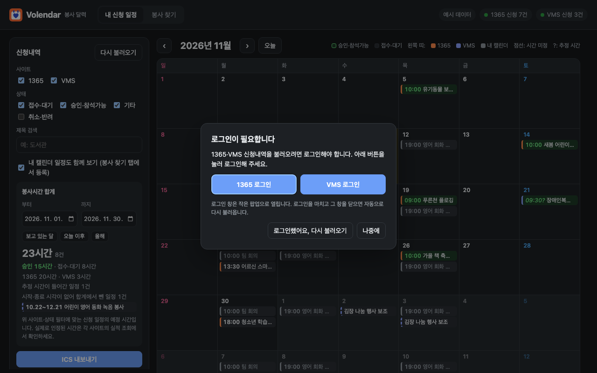
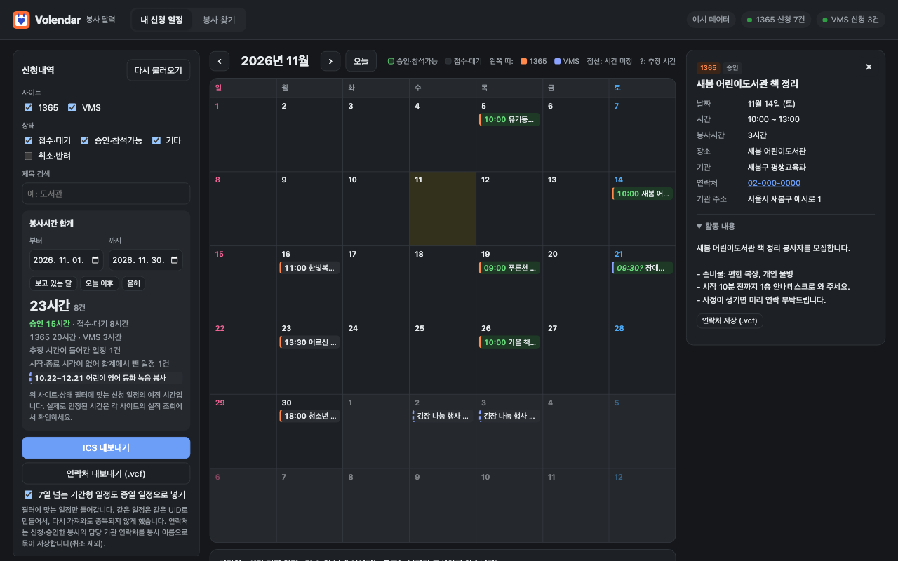
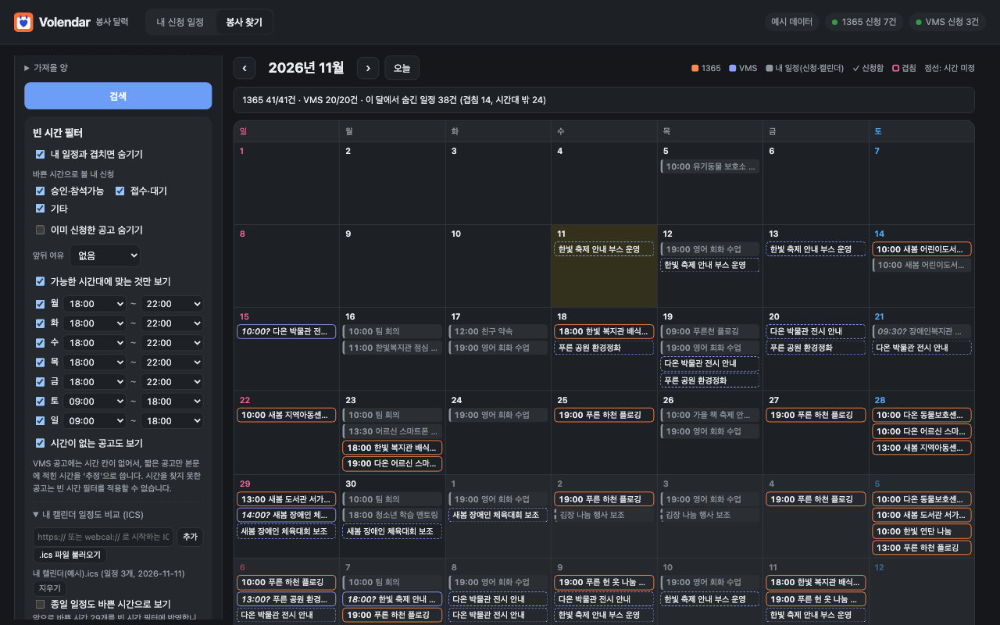
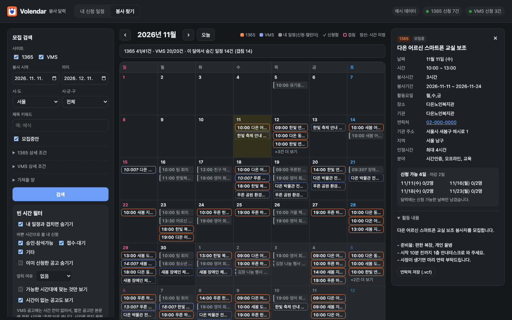
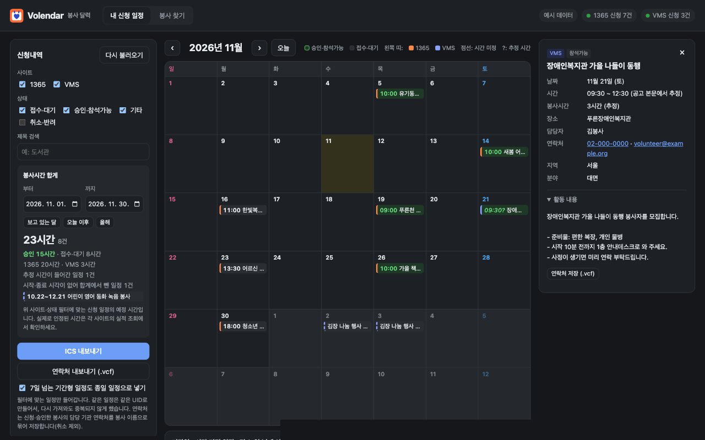

<p align="center">
  <picture>
    <source media="(prefers-color-scheme: dark)" srcset="assets/logo-wordmark-dark.svg">
    
  </picture>
</p>

# Volendar — 봉사 달력

Volendar는 Volunteer와 Calendar를 합친 이름입니다.

1365 자원봉사포털과 VMS(사회복지자원봉사인증관리)에서 **신청한 봉사**와 **모집 중인 봉사**를 한 달력에서 보고, ICS로 내보내는 크롬 확장입니다.

## 설치

1. [최신 릴리스](https://github.com/fixabley/volendar/releases/latest)에서 `volendar-<버전>.zip`을 받아 압축을 풉니다. 코드를 직접 고치려면 `git clone https://github.com/fixabley/volendar.git`으로 받아도 됩니다.
2. 아래 주소를 복사해 Chrome 주소창에 붙여 넣습니다. Chrome 내부 페이지라 링크로는 열리지 않습니다.

   ```text
   chrome://extensions
   ```

3. 오른쪽 위 **개발자 모드**를 켜고, 왼쪽 위 **압축해제된 확장 프로그램 로드**를 눌러 1번에서 압축을 푼 폴더(`manifest.json`이 있는 폴더)를 고릅니다.
4. 툴바의 퍼즐 아이콘을 눌러 **Volendar**를 고정(핀)해 두면 편합니다.

새 버전을 받은 뒤에는 `chrome://extensions`에서 Volendar의 새로고침(↻)을 누르고 달력 탭을 다시 엽니다.

## 사용하기

### 1. 달력 열기와 로그인

툴바의 Volendar 아이콘을 누르면 달력 탭이 열리고, 1365·VMS 신청내역을 바로 불러옵니다. 로그인이 필요하면 안내 창이 뜹니다. **1365 로그인** 또는 **VMS 로그인**을 누르면 로그인 페이지가 작은 팝업 창으로 열리고, 로그인을 마치고 그 창을 닫으면 신청내역을 자동으로 다시 불러옵니다.

<p align="center"></p>

### 2. 내 신청 일정

두 사이트의 신청내역이 한 달력에 모입니다. 칸 왼쪽 띠는 사이트(주황 1365, 남색 VMS), 바탕색은 상태(초록 = 승인·참석가능)입니다. 왼쪽에서 기간을 정하면 봉사시간 합계를 보여주고, 일정을 누르면 활동 내용과 담당 기관 연락처가 나옵니다.

<p align="center"></p>

### 3. 봉사 찾기와 빈 시간 필터

**봉사 찾기** 탭에서 지역·기간·분야로 모집 공고를 검색합니다. 조건을 바꾸면 바로 다시 검색합니다. 회색 칸은 내 일정(신청한 봉사와 불러온 내 캘린더)이고, 겹치는 공고는 숨길 수 있습니다. 요일별로 가능한 시간대를 정하면 그 시간에 맞는 공고만 남습니다.

<p align="center"></p>

### 4. 신청 가능 날짜와 연락처

1365의 기간형 공고는 상세 패널의 **신청 가능 날짜 불러오기**를 누르면 날짜별 모집 상태를 확인해, 신청할 수 있는 날짜만 달력에 남깁니다. 신청은 하지 않습니다. 실제 신청은 **1365에서 보고 신청하기**를 눌러 사이트에서 합니다.

<p align="center"></p>

### 5. 내보내기

- **ICS 내보내기**: 필터에 맞는 신청 일정을 .ics 파일로 받아 Google·Apple 캘린더에 넣습니다.
- **연락처 내보내기 (.vcf)**: 신청·승인한 봉사의 담당 기관 연락처를 봉사 이름으로 묶어 휴대폰 연락처에 저장합니다.

<p align="center"></p>

## 예시 데이터 모드

달력 탭 주소 끝에 `?demo`를 붙여 열면(`chrome-extension://<확장 ID>/src/app.html?demo`) 사이트에 요청하지 않고 지어낸 신청 일정·모집 공고·내 캘린더로 화면을 채웁니다. 스크린샷이나 시연에 쓰면 개인정보가 드러나지 않습니다. 이 모드에서는 설정도 저장하지 않습니다.

## 기능

- **내 신청 일정**: 1365·VMS에 로그인한 브라우저에서 신청내역을 읽어 달력에 표시합니다. 왼쪽 띠는 사이트, 바탕색은 상태(초록 = 승인·참석가능)입니다.
  - 사이트·상태·제목 필터, **봉사시간 합계**(기간 지정), **ICS 내보내기**
  - 각 봉사의 활동 내용과 담당 기관 연락처 표시, 신청·승인한 곳의 **연락처를 봉사 이름으로 묶어 .vcf로 내보내기**
- **봉사 찾기**: 지역·기간·분야 등으로 두 사이트의 모집 공고를 검색해 날짜별로 펼쳐 보여줍니다.
  - **빈 시간 필터**: 내 신청 일정이나 내 캘린더와 겹치는 공고 숨기기, 앞뒤 여유 시간, 요일별 가능 시간대
  - **내 캘린더 비교**: Google·iCloud·Outlook의 ICS 주소나 `.ics` 파일을 불러와 바쁜 시간으로 사용 (다른 캘린더는 파일로)
  - 바쁜 시간으로 볼 신청 상태(승인만, 승인+접수) 선택, 이미 신청한 공고 숨기기

## 알아 둘 점

- 아이디와 비밀번호를 다루지 않습니다. 두 사이트 모두 보안문자나 통합인증(Any-ID)을 거쳐야 해서, **사용자가 브라우저에서 직접 로그인한 세션**으로만 조회합니다. 1365는 30분 동안 아무것도 하지 않으면 로그아웃됩니다.
- ICS는 파일로 내보내며, 자동 갱신 구독 주소는 없습니다. 같은 일정은 같은 UID로 만들어서 다시 가져와도 중복되지 않게 했지만, 캘린더 앱에 따라 기존 일정을 갱신하지 않을 수 있습니다.
- VMS 공고에는 시간 칸이 없습니다. 하루짜리 공고만 본문에서 시간을 찾아 **추정**(`?` 표시)으로 쓰고, 7일 넘게 이어지는 공고는 '기간형' 목록으로 따로 보여줍니다.
- 1365 신청내역은 **최근 1년 안에 신청한 것**만 가져옵니다(사이트의 기간 검색이 신청일 기준이라서).
- 1365 기간형 공고는 처음에 활동요일 기준으로 모든 날짜에 표시됩니다. 실제 신청 가능 날짜는 상세 패널의 **신청 가능 날짜 불러오기**를 눌러야 반영됩니다. 이 버튼은 1365의 신청서 화면을 열어 날짜별 모집 상태만 읽고 신청은 하지 않으며, 누를 때마다 그 공고 하나만 조회합니다(최대 3개월).
- 봉사시간 합계는 **신청 기준 예정 시간**입니다. 실제 인정 시간은 각 사이트의 실적 조회에서 확인하세요.
- 사이트에 부담을 주지 않도록 검색은 앞쪽 몇 페이지만 가져옵니다(설정에서 조정 가능).
- 조회 결과는 저장하지 않습니다. 저장하는 것은 필터 설정, 등록한 캘린더 ICS 주소, 불러온 `.ics` 파일의 시간 정보(제목 제외)뿐이며 모두 이 브라우저 안에만 남습니다.
- 두 사이트의 화면 구조가 바뀌면 파서를 고쳐야 할 수 있습니다.

## 개발

```sh
npm install   # 테스트용 linkedom만 설치
npm test
```

- `src/sources/` 사이트별 조회·파싱, `src/lib/` 날짜·ICS·빈 시간·봉사시간 계산, `src/app.*` 화면
- 테스트 픽스처(`test/fixtures/`)는 실제 마크업 구조를 따르되, 내용은 지어낸 값입니다.
